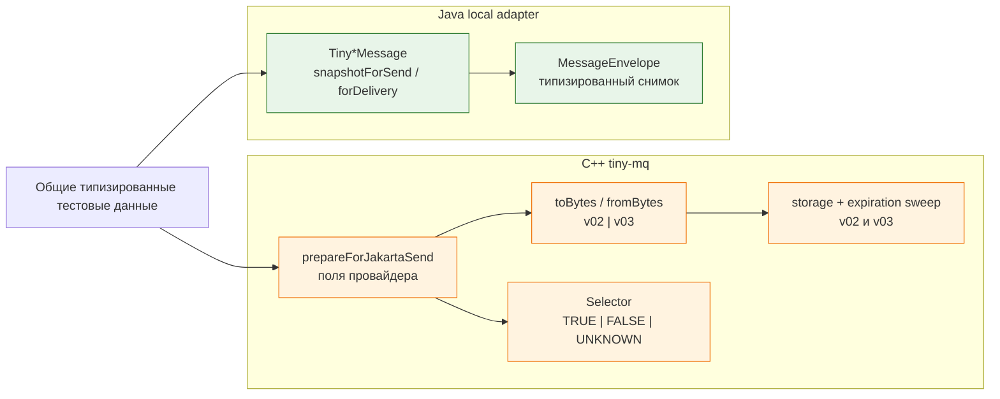

# Объяснение изменения — 70 Контракт сообщений Jakarta Messaging

> Материал для приёмки SDD 70. Вердикты и результаты проверок приведены в отчётах по ссылкам.

- **Спецификация:** `docs/jms-spec/70-jakarta-message-contract.md`, редакция 0.3
  (`docs/jms-spec/70-jakarta-message-contract.md:5`); адресат — Owner SDD 70, Alexander B
  (`docs/jms-spec/70-jakarta-message-contract.md:372-374`).
- **Дельта:** [архив изменения](../../openspec/changes/archive/2026-11-15-70-jakarta-message-contract/specs/jakarta-message-contract/spec.md)
  — только `ADDED Requirements` (`:3-5`).
- **Проверки:** [три раунда ревью](70-jakarta-message-contract.review.md) и
  [отчёт шлюзов NFR/conformance/security](70-jakarta-message-contract.gates.md).
- **Составлено:** `deepseek-flash`, 2026-11-15, стадия объяснения по принятой дельте,
  журналу и отчётам; код прочитан последним только для точных мест трассировки.

## 1. Что изменится в поведении

| Что увидят иначе | Было в постановке до изменения | Стало | Источник |
|---|---|---|---|
| Поля конверта при send | C++ имел частичное собственное представление заголовков; Java-контракт не был принятой спецификацией-фактом | C++ заменяет клиентские значения полей провайдера, выдаёт `ID:` из UUID либо `null`, timestamp из окна send либо `0`; Java получает готовые значения. Redelivery передаётся парой `false/1` или `true/2+` | `spec.md:5-41`; `Message.cpp:304-316`; `JavaMessageAdapter.java:21-80`; `MessageContractTest.CrossLanguageEnvelope` |
| Шесть видов тела и снимок отправки | Покрытие ограничивалось существующим C++ представлением и частью правил | Message, Text, Bytes, Map, Stream и Object сохраняют вид и значения; `Serializable` и массивы копируются, поэтому последующая мутация приложения не меняет снимок | `spec.md:43-71`; `TinyObjectMessage.java:20-53`; `MessageEnvelope.java:32-110`; `MessageContractTest.BodyRoundTrip` |
| Чтение, преобразования и свойства | Не был закреплён полный межъязыковой матричный контракт | Java-объекты применяют read-only/reset/clearBody и таблицы преобразований; свойства типизированы, имя проверяется, полученные свойства read-only до `clearProperties()` | `spec.md:73-127`; тесты `MessageContractTest.BodyAccessMatrix`, `MessageContractTest.PropertyAccessMatrix`; `handoffs/current/70/logs/conformance-r3/java.log:5-8` |
| Селектор | Частичная C++ реализация | Поддерживаются продукции §3.8.1.1–3.8.1.3 и TRUE/FALSE/UNKNOWN; строки не превращаются в числа, long не округляется, `NOT BETWEEN` эквивалентен `value < low OR value > high` | `spec.md:129-157`; `Selector.cpp:481-505`; `handoffs/current/70/logs/conformance-r3/selector-probe.log:1-4` |
| Хранение и истечение | Читался и свипался v02 | v02 остаётся читаемым; расширенные состояния пишутся как v03; свип удаляет просроченные и сохраняет живые записи обеих версий | `spec.md:225-252`; `Message.cpp:124-181`; `ConcurrentLinearStorage.cpp:240-262`; `ExpirationTest.cpp:76-109` |

Сетевой транспорт, Java SE provider и проверка идентификаторов между процессами и
после перезапуска относятся к SDD 73, 74 и 77
(`spec.md:11-12,33-34,222`; `docs/jms-spec/70-jakarta-message-contract.md:44-50`).
`className` хранится как метаданные непрозрачного тела
(`docs/jms-spec/70-jakarta-message-contract.md:60-66`).

## 2. Что изменилось в устройстве

- **Появилось:** версия записи v03 для состояний, которые нельзя представить в v02 без
  потери, и локальный Java-конверт с адаптером — `Message.cpp:146-181`,
  `JavaMessageAdapter.java:20-80`, `MessageEnvelope.java:13-53`.
- **Изменило границу:** C++ вычисляет и хранит конверт; Java принимает готовые
  провайдерские поля и строит локальные объекты `jakarta.jms.Message`. C++ хранит
  сериализованное тело ObjectMessage как непрозрачные байты и сохраняет `className`
  в метаданных тела (`docs/jms-spec/70-jakarta-message-contract.md:44-66`;
  `TinyObjectMessage.java:24-53`). ADR-0008 требует совместного изменения разобранных
  заголовков и кешированных байтов (`arch/0008-header-and-cached-bytes-invariant.md:42-59`).
- **Расширило читателей формата:** общий предикат `hasStorageHeaders` принимает v02 и
  v03; его используют декодер, патч времени и фоновый свип
  (`Message.h:44-48`; `Message.cpp:210-247`; `ConcurrentLinearStorage.cpp:240-262`).
Обе реализации используют общие типизированные тестовые данные
(`spec.md:33-41`). Wire и внешний приём относятся к SDD 73 и 74
(`docs/jms-spec/70-jakarta-message-contract.md:44-50`).

## 3. От установки ObjectMessage до повторной доставки

1. `setObject()` сериализует объект сразу. Последующая мутация исходного объекта
   не меняет эти байты. [TinyObjectMessage.java](../../clients/java/src/main/java/tinymq/jms/TinyObjectMessage.java#L27)
2. `snapshotForSend()` создаёт отдельный конверт с подготовленными заголовками,
   свойствами и телом. [JavaMessageAdapter.java](../../clients/java/src/main/java/tinymq/jms/JavaMessageAdapter.java#L21)
3. При каждой доставке `forDelivery()` восстанавливает экземпляр из конверта и
   получает признак и счётчик доставки отдельными аргументами.
   [JavaMessageAdapter.java](../../clients/java/src/main/java/tinymq/jms/JavaMessageAdapter.java#L45)

Точки проверки — `REQ-70-1` и `REQ-70-2`. [Java-прогон](../../handoffs/current/70/logs/conformance-r3/java.log)

## 4. Связь с намерением и измерения

| Требование | Чем закрыто | Чем подтверждено |
|---|---|---|
| `REQ-70-1` конверт | `Message.cpp:304-316`; `JavaMessageAdapter.java:21-80` | `MessageContractTest.CrossLanguageEnvelope`, `MessageContractTest.V03DeliveryAndTransaction`; `conformance-r3/cpp.log:5-10`, `conformance-r3/java.log:4-5` |
| `REQ-70-2` тела | `TinyObjectMessage.java:20-53`; `MessageEnvelope.java:32-110` | `MessageContractTest.BodyRoundTrip`; `conformance-r3/java.log:6-7` |
| `REQ-70-3` режимы тела | Java message classes и `JavaMessageAdapter` | `MessageContractTest.BodyAccessMatrix`; `conformance-r3/java.log:8-9` |
| `REQ-70-4` свойства | `TinyMessage.java`; `JavaMessageAdapter.java:34-38,67-69` | `MessageContractTest.PropertyAccessMatrix`; `conformance-r3/cpp.log:14-16` |
| `REQ-70-5` селектор | `Selector.cpp:481-505` | `MessageContractTest.SelectorGrammarMatrix`; `selector-probe.log:1-4` |
| `REQ-70-6` горячий путь | изменения `Message`, `MessageProperty`, `Selector` | `NfrGateTest.HotPathBudget`; `nfr-summary.log:1-5` |
| `REQ-70-7` JMSX-группы | снимок свойств и Java-адаптер | `MessageContractTest.GroupProperties`; `conformance-r3/cpp.log:20-22`, `conformance-r3/java.log:12-13` |
| `REQ-70-8` двоичный ID | `Message.h:44`; `Message.cpp:164-181,244-249` | `MessageContractTest.BinaryCorrelationId`; `conformance-r3/cpp.log:23-25`, `conformance-r3/java.log:14-15` |
| `REQ-70-9` v02/v03 | `Message.cpp:172-181,210-247`; `ConcurrentLinearStorage.cpp:240-262` | `MessageContractTest.StorageV02Compatibility`, `ExpirationTest.testExpiredMessageSweptFromStorage`; `conformance-r3/cpp.log:26-33` |

**Измерения REQ-70-6.** RelWithDebInfo, main `9f7983c`, ABBA, медиана CPU time/op
по девяти повторам на сборку:

| Сценарий | main, ns | кандидат, ns | Δ | CV |
|---|---:|---:|---:|---:|
| AutoAck_NonPersistent_RoundTrip | 173.86 | 178.11 | +2.44% | 2.85% / 3.55% |
| AutoAck_Persistent_RoundTrip | 6850.39 | 6926.62 | +1.11% | 2.37% / 1.09% |
| MessageSelector | 3813.02 | 45.13 | −98.82% | 0.95% / 0.94% |

Источник чисел — `handoffs/current/70/logs/nfr-summary.log:1-5`, методика и привязки
сборок — `docs/reviews/70-jakarta-message-contract.gates.md:72-107`, сырые серии —
`handoffs/current/70/logs/nfr-raw.jsonl`.

## 5. Точки решения

| Развилка | Что выбрано | Кто решил | Источник |
|---|---|---|---|
| Как сохранить null, пустой тип и двоичный correlation ID, не искажая v02 | Оставить v02 читаемым, расширенные состояния писать в v03 | Постановка SDD 70 и принятая дельта | `spec.md:225-252`; `openspec/changes/archive/2026-11-15-70-jakarta-message-contract/design.md:24-33` |
| Обновлять ли всех читателей нового формата | Расширить набор и научить свип и патч времени обеим версиям | Раунд ревью 1 и запись `SCOPE-EXPANDED` | `review.md:53-87`; `chain.log:22-28` |
| Как вычислять `NOT BETWEEN` для несовместимых значений | Вычислять как `< low OR > high`, а не инвертировать `>= AND <=` | Дефект раунда conformance-r2, исправление итерации 3 | `gates.md:40-64,111-128`; `Selector.cpp:500-505` |
| Где заканчивается безопасность локального ObjectMessage | В SDD 70 использовать стандартную JVM-политику; per-stream фильтр для внешнего ObjectMessage обязателен в SDD 74 | Отчёт security фиксирует границу | `gates.md:139-177` |
| Как откатываться при наличии v03 | Не запускать старую сборку на общем новом экземпляре вслепую; отдельный проверенный v02, сохранение принятых сообщений и миграция | Постановка и подтверждённая проверка восстановления | `docs/jms-spec/70-jakarta-message-contract.md:346-351`; `design.md:72-79` |

## 6. Цена отката

- **Откатывается:** код SDD 70 и зависимые изменения в обратном порядке зависимостей
  INT-01; для persistent-данных сначала нужен выбранный restore или версионно-безопасная
  миграция (`docs/jms-spec/70-jakarta-message-contract.md:346-351`).
- **Проверенный путь:** старая сборка открыла отдельную восстановленную копию эталонной
  записи TextMessage v02; SHA-256 before/restored совпал, v03 сохранялся отдельным файлом
  (`handoffs/current/70/logs/conformance-r3/storage-restore.log:8-50`;
  `handoffs/current/70/logs/rollback-v02-restore.log:1-15`). Проба охватывает одну эталонную запись.
- **Сохранение принятых сообщений обязательно:** перед откатом после новых записей нужно
  обработать принятые сообщения либо сохранить актуальный экземпляр хранилища и применить
  миграцию, сохраняющую их; восстановление более старого снимка допустимо только после
  этого (`openspec/changes/archive/2026-11-15-70-jakarta-message-contract/design.md:74-79`).
- **Уже необратимо:** внешних сетевых эффектов в границе SDD 70 нет
  (`spec.md:33-34`). Локальный риск — потеря принятых v03-сообщений при откате через
  старый снимок или перезапись без сохранения; путь прямой замены общего хранилища
  проверкой не подтверждён.
- **Класс обратимости:** контролируемое изменение: код откатывается, но persistent-данные
  требуют отдельной операции сохранения/миграции.

## 7. Демонстрация

Не применяется: по `PROJECT.md` слот `DEMO_CMD` равен
`— (сетевого брокера нет)`, а SDD 70 проверяет локальные C++ и Java runner-ы без сети
(`docs/jms-spec/70-jakarta-message-contract.md:44-50`). Сценарий «до и после» через
эфемерный сетевой экземпляр появится на следующем транспортном рубеже.
