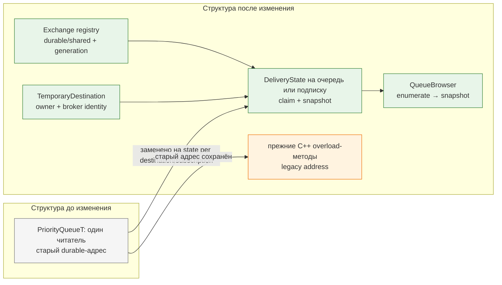
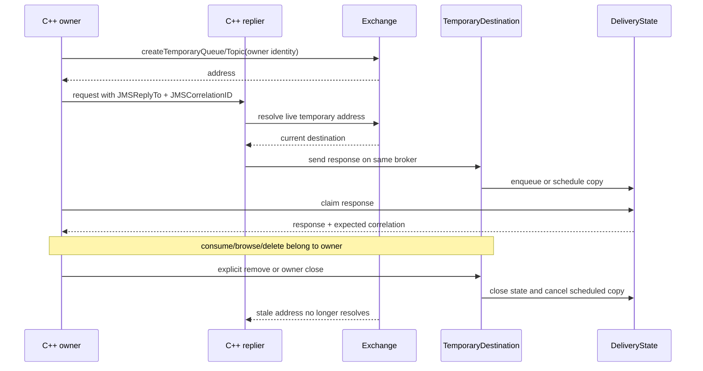

# Объяснение изменения — 71 Назначения Jakarta Messaging

> Материал для решения R1, а не подтверждение корректности. Результаты и границы
> проверок приведены в отчётах по ссылкам.

- **Спецификация:** [SDD 71 v0.6](../jms-spec/71-jakarta-destinations.md#L1-L9);
  адресат — Owner Alexander B ([Owner](../jms-spec/71-jakarta-destinations.md#L287-L289)).
- **Дельта:** [OpenSpec](../../openspec/changes/archive/2026-11-16-71-jakarta-destinations/specs/jakarta-destinations/spec.md#L1-L108),
  [контракт локального C++ API](../../openspec/changes/archive/2026-11-16-71-jakarta-destinations/design.md#L1-L35).
- **Проверки:** [ревью](71-jakarta-destinations.review.md#L216-L334),
  [шлюзы](71-jakarta-destinations.gates.md#L31-L53),
  [производительность](71-jakarta-destinations.nfr.md#L39-L67).
- **Состояние R1:** GitHub perf для проверенного кандидата
  `b4a48b925dca2639d57ded8c02e00af84930e53a` прошёл и верифицирован через прямой
  профиль `deepseek-pro`: пакет DeepSeek V4 Pro записывает `approved`
  ([NFR-отчёт](71-jakarta-destinations.nfr.md#L39-L63),
  [`nfr.json`](../../handoffs/current/71/nfr.json#L30-L36),
  [журнал](../../handoffs/current/71/chain.log#L81-L89)). Текущий выпуск ждёт финального CI:
  журнал доводит задачу до стадии объяснения
  ([`chain.log`](../../handoffs/current/71/chain.log#L100-L107)), а CI задаёт сборку и тесты
  на PR/main ([workflow](../../.github/workflows/ci.yml#L10-L35),
  [тесты](../../.github/workflows/ci.yml#L75-L118)).
- **Составлено:** `deepseek-flash`, 2026-11-16, стадия объяснения; код прочитан после
  дельты, отчётов, ADR и пакетов только для точных ссылок.

## 1. Что изменится в поведении

Локальный C++ контракт получает overload-методы с `noLocal`, shared-подписки,
`QueueBrowser::enumerate()`, временную очередь/топик и явное удаление временного
назначения ([контракт](../../openspec/changes/archive/2026-11-16-71-jakarta-destinations/design.md#L7-L27)).
Сетевой транспорт, авторизация и Java requestor в эту работу не входят
([граница](../../openspec/changes/archive/2026-11-16-71-jakarta-destinations/design.md#L29-L35),
[границы SDD](71-jakarta-destinations.gates.md#L7-L7)).

| Что увидят иначе | Было | Стало | Источник |
|---|---|---|---|
| Конкурирующее чтение очереди | Протокол очереди был рассчитан на одного читателя ([текущее состояние](../jms-spec/71-jakarta-destinations.md#L20-L26)) | Запись атомарно получает одна подходящая сессия; unmatched остаётся другим, claim живёт до разрешения сессией | [REQ-71-1](../../openspec/changes/archive/2026-11-16-71-jakarta-destinations/specs/jakarta-destinations/spec.md#L3-L16), [тест](../../tests/DestinationContractTest.cpp#L45-L149) |
| Топик и durable backlog | Исторический C++ API хранил durable по старому ключу ([текущее состояние](../jms-spec/71-jakarta-destinations.md#L20-L26)) | Каждая выбранная при send/commit подписка получает свою копию; durable хранит persistent backlog через рестарт | [REQ-71-2](../../openspec/changes/archive/2026-11-16-71-jakarta-destinations/specs/jakarta-destinations/spec.md#L18-L31), [тест](../../tests/DestinationContractTest.cpp#L151-L298) |
| Durable-ключи и совместимость | Старый адрес допускал durable без client ID ([текущее состояние](../jms-spec/71-jakarta-destinations.md#L20-L26)) | Новый реестр различает вид подписки и хранит legacy backlog отдельно; прежние overload-методы продолжают открывать старый адрес | [REQ-71-3](../../openspec/changes/archive/2026-11-16-71-jakarta-destinations/specs/jakarta-destinations/spec.md#L33-L46), [тест](../../tests/DestinationContractTest.cpp#L300-L525) |
| Просмотр очереди | Отдельного принятого API просмотра не было; старые SDD описывали незакрытые возможности ([предложение](../../openspec/changes/archive/2026-11-16-71-jakarta-destinations/proposal.md#L5-L10), [текущее состояние](../jms-spec/71-jakarta-destinations.md#L20-L26)) | `enumerate()` возвращает независимый упорядоченный снимок доступных сообщений, не claim и не меняя флаги доставки | [REQ-71-5](../../openspec/changes/archive/2026-11-16-71-jakarta-destinations/specs/jakarta-destinations/spec.md#L63-L76), [тест](../../tests/DestinationContractTest.cpp#L577-L710) |
| Временный request/reply | Старые SDD описывали request/reply как незакрытую возможность ([текущее состояние](../jms-spec/71-jakarta-destinations.md#L20-L26)) | Другое соединение того же брокера отвечает через `JMSReplyTo`; владелец потребляет по `JMSCorrelationID`; удаление/закрытие владельца делает старую ссылку непригодной | [REQ-71-6](../../openspec/changes/archive/2026-11-16-71-jakarta-destinations/specs/jakarta-destinations/spec.md#L78-L91), [тест](../../tests/DestinationContractTest.cpp#L724-L820) |

NoLocal также стал параметром unshared-подписок и фильтруется по идентичности
соединения, а у durable — по client ID
([REQ-71-4](../../openspec/changes/archive/2026-11-16-71-jakarta-destinations/specs/jakarta-destinations/spec.md#L48-L61),
[тест](../../tests/DestinationContractTest.cpp#L527-L575)).

## 2. Что изменилось в устройстве

Схема сопоставляет «одного читателя и старый durable-адрес» с раздельными состояниями
конкретной очереди/подписки и сохраняемой legacy-ветвью
([текущее состояние](../jms-spec/71-jakarta-destinations.md#L20-L26),
[ADR-0009](../../arch/0009-destination-claim-and-ownership.md#L10-L14)).

**Появилось:** отдельное `DeliveryState` для очереди или подписки с атомарным
`claim()` и снимком для браузера
([`Destination.h`](../../server/src/Destination.h#L48-L78),
[`Destination.cpp`](../../server/src/Destination.cpp#L79-L120),
[ADR-0009](../../arch/0009-destination-claim-and-ownership.md#L10-L14)).
**Переехало:** durable/shared identity и поколения backlog теперь ведёт `Exchange`
([`Exchange.h`](../../server/src/Exchange.h#L18-L58),
[`Exchange.cpp`](../../server/src/Exchange.cpp#L308-L450)).
**Изменило границу:** временное назначение принадлежит идентичности соединения;
`Connection::close()` удаляет назначения владельца
([`Connection.cpp`](../../server/src/Connection.cpp#L88-L95),
[`Destination.cpp`](../../server/src/Destination.cpp#L311-L340)).
Старый topic-scoped durable-адрес сохранён отдельной веткой и не смешивается с новым
ключом ([спецификация](../../openspec/changes/archive/2026-11-16-71-jakarta-destinations/specs/jakarta-destinations/spec.md#L35-L35),
[ADR-0009](../../arch/0009-destination-claim-and-ownership.md#L14-L14)).

## 3. Изменённый сценарий временного request/reply

Новый участок — проверка брокера при разрешении и отправке, проверка владельца при
потреблении/удалении, корреляция ответа и отмена отложенной копии
([REQ-71-6](../../openspec/changes/archive/2026-11-16-71-jakarta-destinations/specs/jakarta-destinations/spec.md#L78-L91),
[разрешение и удаление](../../server/src/Exchange.cpp#L251-L306),
[остановка доставки](../../server/src/Destination.cpp#L311-L340)).
Проверка проходит четыре ветви `queue/topic × explicit delete/owner close` и
наблюдает освобождение отложенной копии до deadline
([тест](../../tests/DestinationContractTest.cpp#L724-L820)).

## 4. Связь с намерением и свидетельства по семи требованиям

| Требование | Чем закрыто в продукте | Чем подтверждено |
|---|---|---|
| `REQ-71-1` атомарный claim очереди | `DeliveryState::claim`, порядок приоритетов, holding копии до разрешения сессией ([код](../../server/src/Destination.cpp#L79-L120), [consumer](../../server/src/Consumer.cpp#L31-L70)) | `DestinationContractTest.SelectiveQueueClaim`; шлюз итерации 3 ([отчёт](71-jakarta-destinations.gates.md#L33-L42)) |
| `REQ-71-2` независимый fan-out подписок | выбор подписок в точке публикации и отдельная копия на подписку ([код](../../server/src/Destination.cpp#L438-L485)) | `DestinationContractTest.SubscriptionFanout`; шлюз ([отчёт](71-jakarta-destinations.gates.md#L33-L42)) |
| `REQ-71-3` durable identity, замена, legacy backlog | registry с generation и отдельный старый C++ адрес ([код](../../server/src/Exchange.cpp#L308-L516)) | `DestinationContractTest.DurableIdentityMatrix`; `LegacyDestinationReader.OpensCandidateBacklog` ([прогон](../../handoffs/current/71/logs/conformance-r3-gcc-old-reader.log#L1-L11)); шлюз ([отчёт](71-jakarta-destinations.gates.md#L33-L42)) |
| `REQ-71-4` noLocal по типу подписки | connection identity и client ID применяются в точке публикации ([код](../../server/src/Destination.cpp#L438-L452)) | `DestinationContractTest.NoLocalMatrix`; шлюз ([отчёт](71-jakarta-destinations.gates.md#L33-L42)) |
| `REQ-71-5` неразрушающий browse | `QueueBrowser::enumerate()` вызывает `DeliveryState::snapshot()` ([код](../../server/src/QueueBrowser.cpp#L7-L9), [`Destination.cpp`](../../server/src/Destination.cpp#L107-L120)) | `DestinationContractTest.BrowseWithoutClaim`; шлюз ([отчёт](71-jakarta-destinations.gates.md#L33-L42)) |
| `REQ-71-6` temporary request/reply | временное назначение в `Exchange`, проверка owner/broker, инвалидация ([код](../../server/src/Exchange.cpp#L251-L306)) | `DestinationContractTest.TemporaryReplyLifecycle`; шлюз ([отчёт](71-jakarta-destinations.gates.md#L33-L53)) |
| `REQ-71-7` бюджет горячего пути | hot paths и отдельные concurrent/fan-out profiles ([runner](../../tests/nfr71.py#L12-L22)) | `NfrGateTest.DestinationHotPathBudget`; GitHub CI и независимый пересчёт ([NFR-отчёт](71-jakarta-destinations.nfr.md#L39-L63)) |

Полный набор после правки GCC прошёл `172/172` в 28 наборах, старый reader прочитал
backlog кандидата, а экспорт и трассировка завершились успешно
([прогон](../../handoffs/current/71/logs/conformance-r3-gcc-verify.log#L506-L508),
[reader](../../handoffs/current/71/logs/conformance-r3-gcc-old-reader.log#L1-L11),
[сводка шлюза](71-jakarta-destinations.gates.md#L31-L42)). Это свидетельство шлюза,
а не вердикт этого брифа.

## 5. Точки решения

| Развилка | Что выбрано | Кто решил | Источник |
|---|---|---|---|
| Одна очередь на consumer, глобальный lock или состояние на назначение | Отдельное состояние у очереди/подписки; ожидание и I/O вне критической секции | Архитектурное решение | [ADR-0009](../../arch/0009-destination-claim-and-ownership.md#L10-L18) |
| Как менять durable-конфигурацию, не смешав старый и новый backlog | Новый registry с generation и отдельный адрес legacy; промежуточный metadata-файл фиксируется атомарной заменой | Постановка и conformance-раунд | [REQ-71-3](../../openspec/changes/archive/2026-11-16-71-jakarta-destinations/specs/jakarta-destinations/spec.md#L33-L46), [тест](../../tests/DestinationContractTest.cpp#L346-L525) |
| Кому разрешены операции с временным назначением | Отправка — любому соединению того же брокера с валидной ссылкой; consume/browse/delete — только владельцу | Постановка и ADR | [REQ-71-6](../../openspec/changes/archive/2026-11-16-71-jakarta-destinations/specs/jakarta-destinations/spec.md#L78-L91), [ADR-0009](../../arch/0009-destination-claim-and-ownership.md#L14-L14) |
| Как сравнивать старый и новый persistent receive | Эталон оставляет запись, кандидат синхронно подтверждает её до возврата; обе стороны меряют process CPU | Решение шлюза производительности | [REQ-71-7](../../openspec/changes/archive/2026-11-16-71-jakarta-destinations/specs/jakarta-destinations/spec.md#L93-L104), [NFR-отчёт](71-jakarta-destinations.nfr.md#L3-L10) |
| Продолжать ли после шести критических раундов | Owner разово разрешил шесть раундов и шестнадцать переходов; раунд 6 закрыт без открытых замечаний | Owner | [`chain.log`](../../handoffs/current/71/chain.log#L64-L71), [ревью](71-jakarta-destinations.review.md#L336-L344) |

## 6. Цена отката

- **Откатывается:** код и зависимые изменения в порядке, обратном зависимостям
  INT-01; перед откатом нужно остановить запись, скопировать каталог брокера и
  отдельно сохранить новый durable registry с backlog
  ([Rollback](../jms-spec/71-jakarta-destinations.md#L257-L264)).
- **Проверенный путь совместимости:** кандидат экспортировал копию legacy backlog,
  а старая сборка на `7770feb6…` открыла прежнюю подписку и прочитала `legacy`
  ([прогон рецензента](../../handoffs/current/71/logs/reviewer-r3-legacy-reader.log#L1-L14),
  [описание](71-jakarta-destinations.review.md#L287-L300)).
- **Уже необратимо:** внешних сетевых эффектов в этой работе нет
  ([граница](../../openspec/changes/archive/2026-11-16-71-jakarta-destinations/design.md#L29-L35));
  persistent-данные
  откатываются контролируемо только при сохранении нового registry/backlog и
  сохранении исхода уже подтверждённых записей
  ([Rollback](../jms-spec/71-jakarta-destinations.md#L257-L264)).
- **Класс обратимости:** контролируемое изменение — код можно откатить, но
  persistent-состояние требует отдельной копии и миграционного решения
  ([Rollback](../jms-spec/71-jakarta-destinations.md#L257-L264)).

## 7. Демонстрация

Не применяется: в проекте нет команды эфемерного сетевого экземпляра
(`DEMO_CMD = — (сетевого брокера нет)`, [PROJECT.md](../../PROJECT.md#L73-L73)),
а демонстрируемые локальные сценарии уже имеют воспроизводимые runner-ы в таблице
раздела 4.
