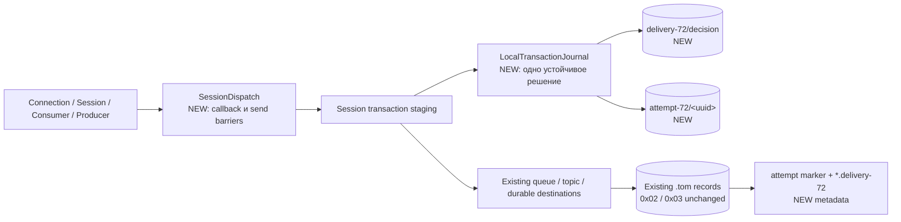
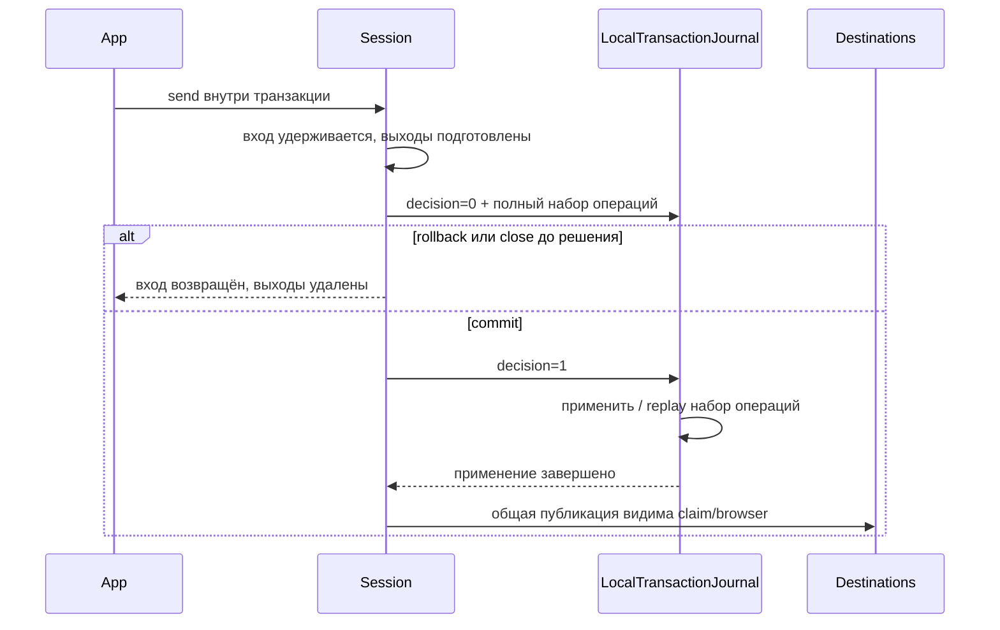

# Объяснение изменения — 72 Доставка, порядок, квитирование и локальные транзакции

> **Это вход человеческого решения** (AEF, Стандарт 4), а не подтверждение корректности. Шлюзы уже
> сформировали свои результаты; здесь объясняется, что меняется для пользователя и устройства
> продукта. Каждое утверждение имеет ссылку на дельту, отчёт, ADR, пакет или место в коде.
>
> Класс документа: **K4 — историческое знание** после приёмки; до приёмки — рабочий вход решения.

- **Спецификация:** [`docs/jms-spec/72-jakarta-delivery.md`](../jms-spec/72-jakarta-delivery.md)
- **Адресат решения:** Owner спецификации Александр Б. или назначенный им инженер-рецензент
  — [`docs/jms-spec/72-jakarta-delivery.md:431-433`](../jms-spec/72-jakarta-delivery.md);
  функция адресата задана [`.claude/agents/explainer.md`](../../.claude/agents/explainer.md)
- **Дельта:** [`openspec/changes/archive/2026-11-19-72-jakarta-delivery/`](../../openspec/changes/archive/2026-11-19-72-jakarta-delivery/)
- **Отчёты:** [`review`](72-jakarta-delivery.review.md), [`gates`](72-jakarta-delivery.gates.md),
  [`NFR`](72-jakarta-delivery.nfr.md)
- **Составлено:** `deepseek-flash`, 2026-11-19 — стадия объяснения, iteration 4

## Состояние перед решением (исторический снимок PR)

Функциональная область `REQ-72-1…8` принята Conformance в iteration 4
([`gates.md:137-140`](72-jakarta-delivery.gates.md)), Reviewer имеет статус `approved`
([`review.md:13-15`](72-jakarta-delivery.review.md)), Security имеет статус `approved`
([`gates.md:252-261`](72-jakarta-delivery.gates.md)). NFR-пакет имеет статус `approved`
только по `approval_basis=owner-approved-deferral`, а его технический результат остаётся
`performance_verdict=rejected`
([`nfr.json:4-5`](../../handoffs/current/72/nfr.json),
[`nfr.md:76-92`](72-jakarta-delivery.nfr.md)). Дельта материализована DocWriter со статусом
`documented` ([`docwriter.json:4-5`](../../handoffs/current/72/docwriter.json)).

Исторический снимок PR №12 на момент составления 2026-11-19 — открыт, не влит: head
`4e85e33a46805a3fd4019bae576ce21ed7d0967f`, `mergeCommit=null`; run ordinary CI
[`44480880600`](https://github.com/bas524/tiny-mq/actions/runs/44480880600) содержит шесть
успешных checks, а релизный check пропущен
([PR №12](https://github.com/bas524/tiny-mq/pull/12)). Это состояние PR, не заявление о
результате `main` CI. Продуктовый шлюз отдельно указывает, что текущее CI-cache продолжение
M-02 на `4e85e33` не входит в его продуктовый вердикт
([`gates.md:168-172`](72-jakarta-delivery.gates.md)).

`REQ-72-9` не входит в восемь требований принятой дельты. Его техническое измерение остаётся
отрицательным: `AutoAck_NonPersistent_RoundTrip` — `106,6 → 113,6 ns/op`, `+6,59%`,
CV `0,57% / 1,73%`, то есть стабильное превышение бюджета 5%
([`nfr.md:60-70`](72-jakarta-delivery.nfr.md)). Owner сделал выбор о выпуске отдельно от
измерения: «Влить по обычному CI, perf — отдельная задача»
([`chain.log:242-243`](../../handoffs/current/72/chain.log)). M-05 остаётся открытой, а
локальное ночное расписание ещё не настроено
([`M-05-local-nightly-performance.md:3-4`](../../tasks/M-05-local-nightly-performance.md),
[`design.md:80-106`](../../openspec/changes/archive/2026-11-19-72-jakarta-delivery/design.md)).
При closure draft из `handoffs/current/72/logs/M-05-local-nightly-performance.md`
скопирован без изменений в [M-05](../../tasks/M-05-local-nightly-performance.md); статус OPEN сохранён.

Closure после EXPLAINED: archive выполнен оператором, 0 ошибок; принятый контракт —
[OpenSpec](../../openspec/specs/jakarta-session-delivery/spec.md). Этот бриф сохраняет
исторический снимок PR; фактические merge и main CI здесь не утверждаются.

## 1. Что изменится в поведении

| Что увидят иначе | Было | Стало | Источник |
|---|---|---|---|
| Время доставки и истечения | Историческая семантика считала delay от commit; без delay записанное значение могло быть нулевым | Один clock sample при принятии send задаёт timestamp (если он не отключён), `deliveryTime=send+delay` и `expiration=send+TTL`, либо `expiration=0` при `TTL=0`; commit, replay и retry эти значения не пересчитывают | `REQ-72-1`, [`spec.md:5-18`](../../openspec/changes/archive/2026-11-19-72-jakarta-delivery/specs/jakarta-message-contract/spec.md), [`docs/jms-spec/72:20-22`](../jms-spec/72-jakarta-delivery.md), [`Producer.cpp:99-114`](../../server/src/Producer.cpp), тест `DeliveryContractTest.SendClockMatrix` |
| Получение и lifecycle | Семантика receive/start/stop была описана не полностью | Новая `Connection` стартует в `stopped`; `start` разрешает получение, `stop` блокирует новые выдачи и ждёт listener; тайм-ауты различают миллисекунды нового API и прежние микросекунды `recv` | `REQ-72-2`, [`connection/spec.md:5-19`](../../openspec/changes/archive/2026-11-19-72-jakarta-delivery/specs/connection/spec.md), [`docs/jms-spec/72:20-22`](../jms-spec/72-jakarta-delivery.md), [`Connection.h:37-40`](../../server/src/Connection.h), [`Consumer.h:28-35`](../../server/src/Consumer.h), тест `DeliveryContractTest.ReceiveLifecycle` |
| Обработка сообщений listener | Callback-доставка не имела единой границы сессии | Один callback `MessageListener` исполняется за раз для всех consumer сессии; stop/close ждёт callback; ошибка listener открывает повтор по правилам режима ack | `REQ-72-3`, [`proposal.md:9-13`](../../openspec/changes/archive/2026-11-19-72-jakarta-delivery/proposal.md), [`jakarta-session-delivery/spec.md:13-25`](../../openspec/changes/archive/2026-11-19-72-jakarta-delivery/specs/jakarta-session-delivery/spec.md), [`Consumer.cpp:208-251`](../../server/src/Consumer.cpp), [`SessionDispatch.cpp:132-165`](../../server/src/SessionDispatch.cpp), тест `DeliveryContractTest.ListenerModeMatrix` |
| Асинхронная отправка | Историческая SDD 21 запрещала транзакционный async send | `sendAsync` принимает обычные или явные `SendOptions`; для принятой операции ровно один callback на потоке, отличном от вызова send, получает заголовки или ошибку; транзакционные async send допустимы в локальной C++-транзакции | `REQ-72-4`, [`jakarta-session-delivery/spec.md:46-63`](../../openspec/changes/archive/2026-11-19-72-jakarta-delivery/specs/jakarta-session-delivery/spec.md), [`Producer.h:30-52`](../../server/src/Producer.h), [`SessionDispatch.cpp:96-129`](../../server/src/SessionDispatch.cpp), тест `DeliveryContractTest.AsyncSendBarriers` |
| Ack, recover и счётчик доставки | Локальные результаты recover/rollback и receiveBody не были сведены в единую матрицу; recover в транзакционной сессии не был запрещён явно | `Session::acknowledge` в CLIENT покрывает выданные записи сессии; recover возвращает только неподтверждённые записи нетранзакционной сессии; порядок выживших повторов сохраняется; `JMSXDeliveryCount` растёт с насыщением; несовместимое тело даёт явный disposition | `REQ-72-5`, [`message-redelivery/spec.md:5-33`](../../openspec/changes/archive/2026-11-19-72-jakarta-delivery/specs/message-redelivery/spec.md), [`docs/jms-spec/72:20-22`](../jms-spec/72-jakarta-delivery.md), [`Session.cpp:466-479`](../../server/src/Session.cpp), [`Destination.cpp:739-832`](../../server/src/Destination.cpp), тест `DeliveryContractTest.AcknowledgeAndRecoverMatrix` |
| Commit локальной транзакции | Атомарность входов и выходов между назначениями и рестарт ещё требовали проверки | Все подтверждения входов и публикации выходов фиксируются одним решением; выходы не видны claim/browser до общей публикации; после решения replay завершает применение; rollback/close до решения возвращает входы и снимает выходы | `REQ-72-6`, [`jakarta-session-delivery/spec.md:80-94`](../../openspec/changes/archive/2026-11-19-72-jakarta-delivery/specs/jakarta-session-delivery/spec.md), [`docs/jms-spec/72:20-22`](../jms-spec/72-jakarta-delivery.md), [`Session.cpp:297-406`](../../server/src/Session.cpp), [`LocalTransactionJournal.cpp:404-480`](../../server/src/LocalTransactionJournal.cpp), тест `DeliveryContractTest.AtomicConsumeAndSend` |
| Повтор и DLQ | Прежний контракт допускал предел 6 по умолчанию, сброс retry-состояния при рестарте и подавление backoff при close | По умолчанию повтор не ограничен, backoff выключен и DLQ не задана; явная политика сохраняет лимит, абсолютный `nextRedeliveryAt`, счётчик и решение переноса при рестарте; close не подавляет backoff | `REQ-72-7`, [`proposal.md:15-20`](../../openspec/changes/archive/2026-11-19-72-jakarta-delivery/proposal.md), [`message-redelivery/spec.md:72-111`](../../openspec/changes/archive/2026-11-19-72-jakarta-delivery/specs/message-redelivery/spec.md), [`Destination.cpp:739-832`](../../server/src/Destination.cpp), тест `DeliveryContractTest.CrashAndDeadLetterMatrix` |
| Порядок отправок | Порядок между разными producer одной сессии не был единым пользовательским контрактом | Общая последовательность принятия send сохраняется между sync/async и в выходах commit; переставить запись могут только priority, наступивший delay и границы режима доставки | `REQ-72-8`, [`proposal.md:9-13`](../../openspec/changes/archive/2026-11-19-72-jakarta-delivery/proposal.md), [`jakarta-session-delivery/spec.md:117-135`](../../openspec/changes/archive/2026-11-19-72-jakarta-delivery/specs/jakarta-session-delivery/spec.md), [`Session.cpp:332-345`](../../server/src/Session.cpp), тест `DeliveryContractTest.SessionSendOrder` |

**Что не изменилось:** форматы сообщений `0x02` и `0x03` и чтение прежних записей сохраняются;
гарантия отказоустойчивости ограничена остановкой процесса и replay в том же каталоге данных
([`design.md:66-71`](../../openspec/changes/archive/2026-11-19-72-jakarta-delivery/design.md),
[`docs/jms-spec/72-jakarta-delivery.md:57-75`](../jms-spec/72-jakarta-delivery.md)). Сетевой
транспорт, Java API/SE, XA, Jakarta EE и кластер остаются в SDD 73–78; эта дельта относится к
локальному C++ ядру ([`proposal.md:30-32`](../../openspec/changes/archive/2026-11-19-72-jakarta-delivery/proposal.md),
[`docs/jms-spec/72-jakarta-delivery.md:34-37`](../jms-spec/72-jakarta-delivery.md)).

## 2. Что изменилось в устройстве

На схеме `NEW` означает добавленный внутренний слой или метаданные, а не новый сетевой протокол;
сетевой транспорт остаётся в SDD 73–78
([`docs/jms-spec/72:34-37`](../jms-spec/72-jakarta-delivery.md)).
`SessionDispatch` координирует две отдельные очереди исполнения listener и completion callback
([`design.md:58-59`](../../openspec/changes/archive/2026-11-19-72-jakarta-delivery/design.md),
[`SessionDispatch.h:19-60`](../../server/src/SessionDispatch.h)). `LocalTransactionJournal`
вводит одну устойчивую границу для commit/DLQ; `attempt-72` хранит состояние повтора, а
`delivery-72/decision` — общий набор операций
([`ADR-0010:16-49`](../../arch/0010-atomic-local-delivery.md),
[`LocalTransactionJournal.h:17-71`](../../server/src/LocalTransactionJournal.h)).

Граница видимости переехала к общей публикации: подготовленные выходы становятся доступны
claim/browser только после применения набора
([`ADR-0010:51-62`](../../arch/0010-atomic-local-delivery.md),
[`Session.cpp:376-398`](../../server/src/Session.cpp)). Старый байтовый формат самих сообщений
остаётся; новыми являются метка тома, фаза первой persistent-попытки и внешние кадры попытки
([`ADR-0010:64-86`](../../arch/0010-atomic-local-delivery.md)). ADR-0010 принят Owner при closure 2026-11-19 (`accepted`); ADR-0009 для владения очередью/подпиской также `accepted`
([`ADR-0010:3`](../../arch/0010-atomic-local-delivery.md),
[`ADR-0009:1-4`](../../arch/0009-destination-claim-and-ownership.md)).

**Удалено из принятой дельты:** семь разрозненных legacy-требований redelivery/drop/backoff
поглощены `REQ-72-5` и `REQ-72-7`; старые противоположные правила, включая default=6 и
сброс состояния при рестарте, больше не действуют
([`message-redelivery/spec.md:228-256`](../../openspec/changes/archive/2026-11-19-72-jakarta-delivery/specs/message-redelivery/spec.md)).
Новых независимых публичных доменных понятий не заявлено:
`product_delta=null` ([`docwriter.json:29`](../../handoffs/current/72/docwriter.json)).

## 3. Изменённый сценарий commit

Новый участок — решение до публикации. До него вход остаётся у сессии, а выходы невидимы; после
устойчивого решения откат запрещён, и replay обязан закончить применение до новых операций.
Это следует из `REQ-72-6` ([`jakarta-session-delivery/spec.md:82-94`](../../openspec/changes/archive/2026-11-19-72-jakarta-delivery/specs/jakarta-session-delivery/spec.md))
и протокола `decision=0/1` ([`ADR-0010:18-27`](../../arch/0010-atomic-local-delivery.md),
[`LocalTransactionJournal.cpp:404-445`](../../server/src/LocalTransactionJournal.cpp)).
Сценарий покрывает остановку до решения, после него и между операциями применения тестом
`DeliveryContractTest.AtomicConsumeAndSend`
([`DeliveryContractTest.cpp:1080`](../../tests/DeliveryContractTest.cpp)).

## 4. Связь с намерением

| Требование спецификации | Чем закрыто | Чем подтверждено |
|---|---|---|
| `REQ-72-1` Send clock, expiration и приоритет | [`Producer.cpp:99-114`](../../server/src/Producer.cpp) | `DeliveryContractTest.SendClockMatrix`; [`gates.md:181`](72-jakarta-delivery.gates.md) |
| `REQ-72-2` Синхронное получение и lifecycle | [`Connection.h:37-40`](../../server/src/Connection.h), [`Consumer.h:28-35`](../../server/src/Consumer.h) | `DeliveryContractTest.ReceiveLifecycle`; [`gates.md:182`](72-jakarta-delivery.gates.md) |
| `REQ-72-3` Listener и граница сессии | [`Consumer.cpp:208-251`](../../server/src/Consumer.cpp), [`SessionDispatch.cpp:132-165`](../../server/src/SessionDispatch.cpp) | `DeliveryContractTest.ListenerModeMatrix`; [`gates.md:183`](72-jakarta-delivery.gates.md) |
| `REQ-72-4` Завершение асинхронной отправки | [`Producer.cpp:69-97`](../../server/src/Producer.cpp) | `DeliveryContractTest.AsyncSendBarriers`; [`gates.md:184`](72-jakarta-delivery.gates.md) |
| `REQ-72-5` Квитирование, recover и receiveBody | [`Session.cpp:466-479`](../../server/src/Session.cpp), [`Destination.cpp:739-832`](../../server/src/Destination.cpp) | `DeliveryContractTest.AcknowledgeAndRecoverMatrix`; [`gates.md:185`](72-jakarta-delivery.gates.md) |
| `REQ-72-6` Атомарная локальная транзакция | [`Session.cpp:297-406`](../../server/src/Session.cpp), [`LocalTransactionJournal.cpp:404-480`](../../server/src/LocalTransactionJournal.cpp) | `DeliveryContractTest.AtomicConsumeAndSend`; [`gates.md:186`](72-jakarta-delivery.gates.md) |
| `REQ-72-7` Доставка после отказа и DLQ | [`Destination.cpp:739-832`](../../server/src/Destination.cpp) | `DeliveryContractTest.CrashAndDeadLetterMatrix`; [`gates.md:187`](72-jakarta-delivery.gates.md) |
| `REQ-72-8` Порядок отправок одной сессии | [`Session.cpp:332-345`](../../server/src/Session.cpp) | `DeliveryContractTest.SessionSendOrder`; [`gates.md:188`](72-jakarta-delivery.gates.md) |

Расхождение с первоначальной картиной зафиксировано явно: состав подписок топика выбирается
при commit, хотя Jakarta §7.9 привязывает его к send; это локальное решение SDD 71/72 и
ADR-0009, а не перенос текущей C++-семантики в отображение Java
([`gates.md:241-244`](72-jakarta-delivery.gates.md),
[`ADR-0009:10-14`](../../arch/0009-destination-claim-and-ownership.md)).

## 5. Точки решения

| Развилка | Что выбрано | Кто решил | Источник |
|---|---|---|---|
| Считать delay/TTL от send или от commit | Для новых записей — от send; исторические записи сохраняют записанные заголовки | SDD 72 как замена исторического правила SDD 13 | [`message-contract/spec.md:5-18`](../../openspec/changes/archive/2026-11-19-72-jakarta-delivery/specs/jakarta-message-contract/spec.md) |
| Выбирать состав топика при send или при commit | Для локального C++ контракта — при commit, с сохранением идентичности поколения подписки | SDD 71/72 и ADR-0009; Java mapping не заявляется | [`gates.md:241-244`](72-jakarta-delivery.gates.md) |
| Делать commit набором независимых записей или одним устойчивым решением | Выбран один журнал решения, `attempt-72` и метка тома; ADR принят Owner при closure 2026-11-19 (`accepted`) | SDD 72 и ADR-0010 | [`ADR-0010:3-35`](../../arch/0010-atomic-local-delivery.md), [`proposal.md:22-24`](../../openspec/changes/archive/2026-11-19-72-jakarta-delivery/proposal.md) |
| Остановиться на rejected perf или продолжить выпуск с долгом | Owner допустил обычный CI, `perf` вынесен в M-05; отрицательные данные не заменены на pass | Owner | [`chain.log:242-243`](../../handoffs/current/72/chain.log), [`nfr.md:76-92`](72-jakarta-delivery.nfr.md) |
| Завершать слияние сейчас или оставить его человеку | PR №12 остаётся открытым в состоянии перед merge; это R1-действие | Owner по границе автономности | [`PROJECT.md:85`](../../PROJECT.md), [PR №12](https://github.com/bas524/tiny-mq/pull/12) |

## 6. Цена отката

- **До слияния:** откат затрагивает ревизию открытого merge-кандидата; PR №12 по-прежнему открыт,
  а merge относится к R1
  ([PR №12](https://github.com/bas524/tiny-mq/pull/12), [`docs/jms-spec/72:409-412`](../jms-spec/72-jakarta-delivery.md)).
- **После начала записи новых данных:** нужен управляемый откат с остановкой приёма, завершением replay,
  резервной копией и переносом состояния нового журнала; простая замена кода не заменяет эту процедуру
  ([`ADR-0010:92-120`](../../arch/0010-atomic-local-delivery.md),
  [`docs/jms-spec/72:400-407`](../jms-spec/72-jakarta-delivery.md)).
- **Что сохраняется:** форматы сообщений `0x02/0x03` и прежние смещения полей не заменяются; старые
  записи читаются с сохранёнными заголовками
  ([`ADR-0010:64-72`](../../arch/0010-atomic-local-delivery.md),
  [`design.md:66-71`](../../openspec/changes/archive/2026-11-19-72-jakarta-delivery/design.md)).
- **Что уже не откатывается автоматически:** после появления новых журналов и меток откат требует
  переноса активных попыток/решений либо остановки процедуры с сохранением обеих копий
  ([`ADR-0010:92-120`](../../arch/0010-atomic-local-delivery.md)).
- **Класс обратимости:** контролируемый, а не автоматически обратимый: источник допускает безопасную
  процедуру с резервной копией, но не обещает простое переключение старого кода на новые данные
  ([`docs/jms-spec/72:400-407`](../jms-spec/72-jakarta-delivery.md)).

Отдельный долг `REQ-72-9` не откатывается вместе с PR: M-05 остаётся открытой и закрывается только
валидными сравнительными данными и выполнением бюджета
([`M-05-local-nightly-performance.md:42-60`](../../tasks/M-05-local-nightly-performance.md)).

## 7. Демонстрация

Раздел удалён: эфемерного сетевого брокера и команды «до и после» в проекте нет
(`DEMO_CMD` — `— (сетевого брокера нет)`,
[`PROJECT.md:81`](../../PROJECT.md)); SDD ограничивает проверку локальным C++ ядром и
отдельным runner НФТ
([`docs/jms-spec/72:34-37`](../jms-spec/72-jakarta-delivery.md)). Поэтому здесь нет
исполняемого пользовательского сценария, который можно выдать за свидетельство.

## Отчёт оператора: оснастка и затраты

Срез usage на 19.11.2026 08:18 UTC охватывает работу с SDD 72 с 16.11.2026
16:04:32 UTC, включая неуспешные попытки, orchestration и сопровождение.
Слияние и CI main на этом срезе ещё не выполнены. После них итоговые счётчики
публикуются в сообщении приёмки; этот срез не выдаётся за окончательный счёт.

Пройдены восемь основных стадий из chain.env: Critic, Producer, Reviewer, NFR,
Conformance, Security, DocWriter, Explainer; журнал дошёл до EXPLAINED на
переходе 40. Исключение потолка относится только к SDD 72; штатные 12/5 не изменены.
Orchestrator и Platform выполняли сопровождение цепочки/CI, Knowledge Gardener
закрыл знание. Analyst заново не запускался: INT и постановка уже существовали.
Это не двенадцать одинаково обязательных отдельных запусков на каждую SDD.
Модели стадий соответствуют [.claude/chain/chain.env](../../.claude/chain/chain.env):
автор/Conformance/DocWriter/Gardener — OpenAI; критик/Reviewer/NFR/Security —
прямой DeepSeek Pro; Explainer — прямой DeepSeek Flash.

Независимые проверки выявили и закрыли дефекты тайм-аутов, callback/recover,
транзакционных границ, повторной доставки после сбоя и очистки через root alias.
Свидетельства: [gates](72-jakarta-delivery.gates.md),
[review](72-jakarta-delivery.review.md), [M-01](../../tasks/M-01-attempt-cleanup-root-alias.md).
Полный Debug 180/180, Release delivery 8/8 и clang-tidy прошли; Security повторён
на финальном runtime (probes A–F). Сравнение 132 файлов между проверенной
рабочей копией и публикацией `4e85e33` не нашло расхождений.

Оснастка обеспечила независимость и проверку свидетельств, но эффективность
по времени и токенам недостаточна: многочисленные возвраты, повторная передача
большого контекста и ожидание CI увеличили стоимость. Обнаруженный дефект кэша
исправлен и проверен в [M-02](../../tasks/M-02-asan-vcpkg-image-cache.md).
НФТ не пройден: технический rejected сохранён, Owner разрешил только отдельный
выпуск с открытым долгом [M-05](../../tasks/M-05-local-nightly-performance.md).
Дальнейшее улучшение оснастки — компактные пакеты для новых стадий, ожидание CI
без LLM-опросов и явное различение технического результата/Owner waiver.

| Область | Оценка по usage |
|---|---:|
| GPT-6.1 Sol: orchestration | 1902.77 Standard credits |
| GPT-6.1 Sol: стадии и M-01/M-02 | 601.42 Standard credits |
| M-03: не опубликованный прототип ускорения GitHub perf | 7.48 Standard credits |
| GPT всего, включая M-03 | 2511.67 Standard credits |
| DeepSeek Pro | $14.3534 |
| DeepSeek Flash | $0.1532 |
| DeepSeek всего | $14.5066 |

Методика: дельты cumulative token_count из локальных Codex rollout, вход без
двойного подсчёта cached tokens, output включает reasoning ровно один раз;
DeepSeek учитывает UTC peak/off-peak каждого события. Это расчётная стоимость,
не банковское списание. GPT рассчитан по [тарифу Standard credits](https://learn.chatgpt.com/docs/pricing)
50 / 2,5 / 250 за миллион uncached input / cached input / output; денежная
стоимость credits зависит от плана, поэтому долларовое списание GPT не заявляется.
DeepSeek использует [официальные тарифы](https://api-docs.deepseek.com/quick_start/pricing/).
Расчёт и сырые счётчики: `handoffs/current/72/model-usage.py`,
`handoffs/current/72/logs/model-usage-20261119-0818.log`; полный rollout остаётся локально.
Официальный прямой `/user/balance` даёт баланс аккаунта, не стоимость SDD: на
08:10:57 UTC остаток $17,42; ответ сохранён в `logs/deepseek-balance-api.json`.
Пополнения и посторонние задачи не считаются расходом этой SDD.
