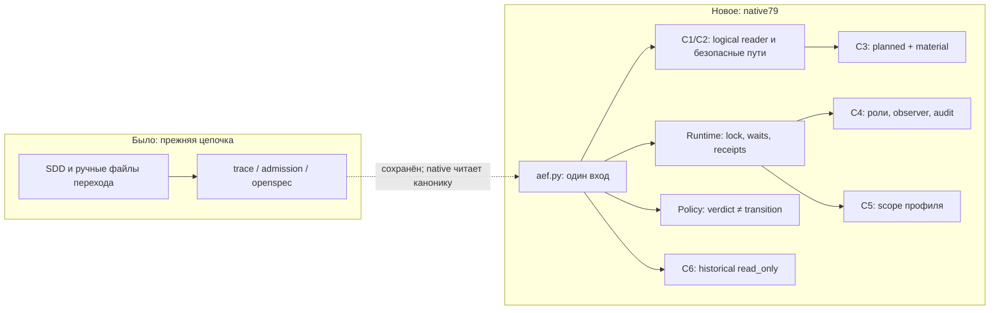
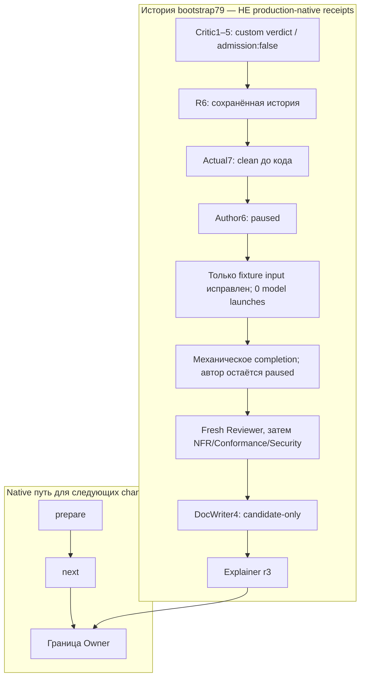

# Объяснение изменения — 79 «Сокращённая оснастка AEF»

> Исторический снимок принятого change 79. Ссылки на handoffs относятся к
> локальному аудиту в общем Git-каталоге `aef-audit/bootstrap-79/`.

> Это вход решения Owner. Ниже — что меняется, где границы и что пока не доказано.
> Относительные ссылки рассчитаны от канонического `openspec/changes/79-aef-journey-harness/acceptance.md`.

- **Спецификация:** [proposal.md](proposal.md#L1), [design.md](design.md#L1), [tasks.md](tasks.md#L1), [дельта](specs/aef-workflow/spec.md#L1).
- **Код:** [5f87b6b](../../../../handoffs/current/79/review-subject.json#L2); исходные идентичности восьми файлов — [review-subject.json](../../../../handoffs/current/79/review-subject.json#L4).
- **Технические пакеты:** [Critic7](../../../../handoffs/current/79/critic-r7-output/result.json#L1), [Reviewer](../../../../handoffs/current/79/reviewer-r5-output/result.json#L1), [NFR](../../../../handoffs/current/79/nfr-r3-output/result.json#L1), [Conformance](../../../../handoffs/current/79/conformance-r4-output/result.json#L1), [Security](../../../../handoffs/current/79/security-r5-output/result.json#L1).
- **Составлено:** Explainer, `deepseek-flash`, независимо от автора; это не вердикт ролей выше.

## Актуальный снимок для приёмки

Коммит `889d1be` добавляет проверку заявленных файлов `evidence` при обычном завершении и восстановлении. Путь должен вести к непустому обычному файлу в выводе роли. Перед использованием восстановленного результата Runtime проверяет путь ещё раз. Валидный результат сохраняет исходное исполнение. [Задача M‑06](../../../../tasks/M-06-compact-runtime-provider-smoke.md#L6)

DeepSeek Flash независимо одобрил этот дифф без замечаний и сам прогнал 18 тестов Runtime. Общий локальный прогон дал 40 успешных тестов и 2 пропуска. [Вердикт и логи](../../../../handoffs/current/79/reviewer-evidence-output/result.json)

Разделы ниже описывают исходную миграцию `5f87b6b` и её пакеты AEF. Номера строк в ссылках на изменённые файлы обновлены. Текущие хеши и границы решений собраны в [пакете приёмки](../../../../handoffs/current/79/owner-review.json).

## 1. Что изменится в поведении

| Что увидят иначе | Было | Стало | Источник |
|---|---|---|---|
| Работа с change | Переходы и ожидание собирались вручную | Один вход `aef.py`: `status`, `next`, `record-decision`; `prepare`/`verify`/`resume`/`archive` — технические операции | [проблема](proposal.md#L9), [REQ-79-2](specs/aef-workflow/spec.md#L25), [CLI](../../../../.claude/chain/aef.py#L13), [архитектура](design.md#L7) |
| Ожидание и повтор | Ручные опросы и отдельные status-файлы | `status` не опрашивает модель; захват идёт через OS-lock; ожидание/Owner-граница возвращают state без нового запуска | [проблема](proposal.md#L9), [REQ-79-8](specs/aef-workflow/spec.md#L131), [status](../../../../.claude/chain/workflow_runtime.py#L421), [next](../../../../.claude/chain/workflow_runtime.py#L593) |
| Разрешение перехода | Технический `approved` и разрешение Owner смешивались | `technical_verdict` и `transition` раздельны; ход открывает только привязанное к карточке подлинное user-сообщение | [REQ-79-3](specs/aef-workflow/spec.md#L39), [policy](../../../../.claude/chain/workflow_policy.py#L79), [граница](design.md#L194) |
| Архив и профиль | Archive смешивался с активным чтением; harness принимал C++ target | Archive — только явный `read_only`; C++ профиль `unavailable`, target блокируется до модели | [REQ-79-6](specs/aef-workflow/spec.md#L93), [REQ-79-7](specs/aef-workflow/spec.md#L112), [профиль](design.md#L121) |

**Что не изменилось:** продуктовый C++/Java, зависимости, JMS и факт OpenSpec до решения Owner; M-05 и rejected performance открыты — [ограничения](proposal.md#L29), [pending](tasks.md#L53), [M-06](../../../../tasks/M-06-compact-runtime-provider-smoke.md#L3).

## 2. Что изменилось в устройстве



- **C1 — логический reader.** Пять файлов читаются напрямую, без копии SDD; проверяются поля INT/SDD, видимое содержимое, заглушки, реестр, источники и Test — [design](design.md#L57), [reader](../../../../.claude/chain/workflow_contract.py#L203).
- **C2 — пути до чтения.** Symlink в файле/родителе, `..`, выход из корня и лишняя delta отклоняются до read — [design](design.md#L69), [проверка](../../../../.claude/chain/workflow_contract.py#L16).
- **C3 — план отдельно от материала.** `contract_hash` — projected-файлы; нормализуются только Work checkbox и тела `Results`/`Owner decisions`; `material_hash` хранит raw и позднее acceptance — [design](design.md#L77), [код](../../../../.claude/chain/workflow_contract.py#L303).
- **C4 — доверие и изоляция.** `Results`/`Owner decisions` не дают полномочий; Owner-source сверяет thread/message/turn, цитату, digest и `provenance=user`; модели автора и Reviewer разных провайдеров; observer заморожен, audit namespace лежит вне worktree — [design](design.md#L89), [source](../../../../.claude/chain/workflow_policy.py#L11), [роли](../../../../.claude/chain/workflow_runtime.py#L796), [observer](../../../../.claude/chain/workflow_runtime.py#L913), [audit](../../../../.claude/chain/workflow_runtime.py#L296). `approved` источника не равен разрешению Owner: карточка и точный user-record проверяются отдельно — [граница](design.md#L199).
- **C5 — профиль.** Registry разрешает только `.claude/chain`; `server/*.cpp`, `clients/*` и C/C++ targets блокируются без fallback на harness/NFR N/A — [registry](../../../../.claude/chain/workflow-checks.json#L159), [проверка](../../../../.claude/chain/workflow_runtime.py#L359).
- **C6 — архив.** Активный reader не принимает archive; `historical=True` даёт `read_only`; оригинальные файлы, acceptance и manifest сохраняются до rebase — [design](design.md#L128), [original](design.md#L137), [archive](../../../../.claude/chain/workflow_runtime.py#L1180). Legacy archive явно отказывает native — [refusal](../../../../.claude/chain/openspec.py#L281).

`next` сам делает механические переходы, запускает разрешённую стадию и ждёт до границы Owner; `status` и ожидание не создают лишний модельный вызов — [сценарий](design.md#L151).

## 3. Изменённый сценарий



Critic1–5 использовали custom-вердикты (`needs-work`/`content-clean`) и `admission:false`; это не полный допуск — [R1](../../../../handoffs/current/79/history/round1/design-critic.json#L7), [R3](../../../../handoffs/current/79/history/round3/design-critic.json#L5), [R5](../../../../handoffs/current/79/critic-r5-output/result.json#L5), [границы](../../../../handoffs/current/79/critic-r5-output/report.md#L55). Actual6 сохранён как история, не как текущий witness — [R6](../../../../handoffs/current/79/history/before-critic7-critic.json#L7). Actual7 был `clean` до кода на исправленном контракте; он сам вычислил raw и planned-v2, совпавшие с новым reader — [R7](../../../../handoffs/current/79/critic-r7-output/result.json#L6), [до кода](../../../../handoffs/current/79/critic-r7-output/report.md#L4), [witness](../../../../handoffs/current/79/critic-r7-output/logs/bootstrap-identity.log#L1), [совпадение](../../../../handoffs/current/79/critic-r7-output/logs/bootstrap-identity.log#L14). После реализации genuine router заново зарегистрировал Actual7: дорегистрационная запись сохранена, новая содержит `planned-v2` — [старая](../../../../handoffs/current/79/history/before-critic7-critic.input.json#L4), [новая](../../../../handoffs/current/79/critic.input.json#L4), [журнал](../../../../handoffs/current/79/chain.log#L134), [проверка](../../../../handoffs/current/79/conformance-r4-output/report.md#L30).

Actual Author6 вернул `paused` из-за противоречия observer-теста и fixture `code_paths` — [пакет](../../../../handoffs/current/79/author-r6-output/implementation-report.json#L5). Координатор изменил только fixture input, не assertions/код; production-байты совпали, новых модельных запусков нет — [поправка](../../../../handoffs/current/79/fixture-correction.json#L6), [неизменность](../../../../handoffs/current/79/fixture-correction.json#L9), [production](../../../../handoffs/current/79/fixture-correction.json#L10), [ноль](../../../../handoffs/current/79/fixture-correction.json#L18). В журнале затем виден и `produced`, но это механическое completion координатора, а не смена ответа автора; пакет автора остаётся `paused` — [paused](../../../../handoffs/current/79/chain.log#L138), [produced](../../../../handoffs/current/79/chain.log#L141), [completion](../../../../handoffs/current/79/author6-mechanical-completion.json#L3). Fresh Reviewer независимо проверил поправку: C5 не ослаблен, assertions/байты неизменны, новых запусков нет — [reviewer](../../../../handoffs/current/79/reviewer-r5-output/report.md#L54). M06 перечисляет реальные дефекты до активации — [M06](../../../../tasks/M-06-compact-runtime-provider-smoke.md#L23). Первый adversarial на narrow fixture дал exit 1 и сохранён; текущие 8 эквивалентных проверок прошли — [failed](../../../../handoffs/current/79/logs/operator-r6/checks.json#L87), [8/8](../../../../handoffs/current/79/logs/operator-r6/adversarial-current.log#L11).

## 4. Связь с намерением

| Требование | Чем закрыто | Чем подтверждено |
|---|---|---|
| [REQ-79-1](specs/aef-workflow/spec.md#L5) | Native logical reader и виртуальный SDD | workflow35: 33 pass, 2 opt-in skip — [лог](../../../../handoffs/current/79/logs/operator-r6/workflow.log#L7), [trace](../../../../handoffs/current/79/logs/operator-r6/sdd.log#L1) |
| [REQ-79-2](specs/aef-workflow/spec.md#L25) | OS-lock, interruption, resume, status без poll | workflow-интеграция — [workflow](../../../../handoffs/current/79/logs/operator-r6/workflow.log#L7), [runtime](../../../../.claude/chain/workflow_runtime.py#L593) |
| [REQ-79-3](specs/aef-workflow/spec.md#L39) | Точная Owner-карточка и source binding | policy3 — [лог](../../../../handoffs/current/79/logs/operator-r6/policy.log#L3) |
| [REQ-79-4](specs/aef-workflow/spec.md#L54) | Роли, observer, native guard | native 1/1; оба probe прошли — [native](../../../../handoffs/current/79/logs/operator-r6/native-policy.log#L5), [OpenAI](../../../../handoffs/current/79/logs/real-probes-20261121T092325Z/result.json#L16), [direct DeepSeek](../../../../handoffs/current/79/logs/real-probes-20261121T092325Z/result.json#L91) |
| [REQ-79-5](specs/aef-workflow/spec.md#L73) | Planned/material и свежесть receipt | DocWriter independently proved stable planned/exact material — [proof](../../../../handoffs/current/79/docwriter-r4-output/logs/projection-proof.json#L40) |
| [REQ-79-6](specs/aef-workflow/spec.md#L93) | Original bytes, read-only history, audit | Conformance/Security — [conformance](../../../../handoffs/current/79/conformance-r4-output/report.md#L20), [security](../../../../handoffs/current/79/security-r5-output/report.md#L39) |
| [REQ-79-7](specs/aef-workflow/spec.md#L112) | Legacy preservation и C++ unavailable | NFR `not_applicable`, `measured=false`; профиль/legacy проверены — [NFR](../../../../handoffs/current/79/nfr-r3-output/result.json#L23), [conformance](../../../../handoffs/current/79/conformance-r4-output/report.md#L21) |
| [REQ-79-8](specs/aef-workflow/spec.md#L131) | Attempts, waits, transition kinds | CLI 30 команд, 6 blocked, 0 models — [CLI](../../../../handoffs/current/79/logs/operator-r6/whole-cli.log#L1), [negative](../../../../handoffs/current/79/logs/operator-r6/mechanical-green.json#L8) |

Операторские проверки: workflow35 — 33 pass, 2 opt-in skip (не pass); policy3; legacy2; 8 adversarial; установленная CLI — 30 команд, 6 blocked, 0 моделей; native guard — [workflow](../../../../handoffs/current/79/logs/operator-r6/workflow.log#L7), [policy](../../../../handoffs/current/79/logs/operator-r6/policy.log#L3), [legacy](../../../../handoffs/current/79/logs/operator-r6/legacy.log#L3), [adversarial](../../../../handoffs/current/79/logs/operator-r6/adversarial-current.log#L11), [CLI](../../../../handoffs/current/79/logs/operator-r6/whole-cli.log#L1), [negative](../../../../handoffs/current/79/logs/operator-r6/mechanical-green.json#L8), [native](../../../../handoffs/current/79/logs/operator-r6/native-policy.log#L5). Оба synthetic provider probe прошли на актуальном коде для OpenAI и direct DeepSeek; 2 QA-вызова вне role budget, без product admission — [код](../../../../handoffs/current/79/logs/real-probes-20261121T092325Z/result.json#L13), [итог](../../../../handoffs/current/79/logs/real-probes-20261121T092325Z/result.json#L177), [QA](../../../../handoffs/current/79/dispatch-budget.json). Skip нативного/платного не объявлен pass — [граница](../../../../handoffs/current/79/conformance-r4-output/report.md#L11).

Текущие `approved` Reviewer/NFR/Conformance/Security — технические пакеты, не решение этого объяснения и не Owner acceptance — [Reviewer](../../../../handoffs/current/79/reviewer-r5-output/result.json#L5), [NFR](../../../../handoffs/current/79/nfr-r3-output/result.json#L5), [Conformance](../../../../handoffs/current/79/conformance-r4-output/result.json#L5), [Security](../../../../handoffs/current/79/security-r5-output/result.json#L5).

## 5. Точки решения

| Развилка | Что фактически выбрано | Источник |
|---|---|---|
| Как считать bootstrap-критику | Critic1–5 и Actual6 не выдавать за текущий допуск; Actual7 — clean до кода и genuine re-registration | [R5](../../../../handoffs/current/79/critic-r5-output/result.json#L5), [R6](../../../../handoffs/current/79/history/before-critic7-critic.json#L7), [R7](../../../../handoffs/current/79/critic-r7-output/result.json#L6) |
| Противоречие observer-теста | `paused` не выдавать за produced; исправить только fixture input, затем независимо проверить | [pause](../../../../handoffs/current/79/author-r6-output/implementation-report.json#L5), [fix](../../../../handoffs/current/79/fixture-correction.json#L2), [review](../../../../handoffs/current/79/reviewer-r5-output/report.md#L52) |
| Лимиты | Только 79: 36 dispatch, 7 critic, 6 author, два infra-reserve; глобальные 12/5/5 не менялись | [решение](../../../../handoffs/current/79/owner-limit-application.json), [chain.env](../../../../.claude/chain/chain.env#L7) |
| Расход | 35/36, critic7/7, author6/6; DocWriter3 — 28-секундный infrastructure refusal из-за stale r2 prompt/base/output, usage сохранён; использован 1/2 reserve | [dispatch](../../../../handoffs/current/79/dispatch-budget.json), [critic](../../../../handoffs/current/79/dispatch-budget.json), [author](../../../../handoffs/current/79/author-r6-output/implementation-report.json#L6), [reason](../../../../handoffs/current/79/dispatch-budget.json), [start](../../../../handoffs/current/79/docwriter-r3-output/observer.json#L7), [finish](../../../../handoffs/current/79/docwriter-r3-output/observer.json#L67), [usage](../../../../handoffs/current/79/docwriter-r3-output/events.jsonl#L11), [reserve](../../../../handoffs/current/79/dispatch-budget.json) |
| Документация | DocWriter4: candidate patch семи существующих документов; planned hash стабилен, exact material изменён; не применён | [candidate](../../../../handoffs/current/79/docwriter-r4-output/manifest.json#L2), [paths](../../../../handoffs/current/79/docwriter-r4-output/manifest.json#L11), [planned](../../../../handoffs/current/79/docwriter-r4-output/logs/projection-proof.json#L40), [material](../../../../handoffs/current/79/docwriter-r4-output/logs/projection-proof.json#L41), [not applied](../../../../handoffs/current/79/logs/operator-r6/docwriter-patch-check.json#L13) |
| Archive | Native state79 отсутствует; legacy archive отказывает native; full production archive не выполнялся | [preflight](../../../../handoffs/current/79/logs/operator-r6/closing-preflight.json#L3), [refusal](../../../../.claude/chain/openspec.py#L281) |

Экономия не измерена: структурная цель — гипотеза, credits не USD. `model-usage-current` — оценка по frozen-ставкам SDD72; окно Root включает также отчёт/permission work, а два failed attempts имеют неизвестный расход, не ноль; `invoice_verified=false` — [proposal](proposal.md#L44), [метод](../../../../handoffs/current/79/model-usage-current.json), [unknown](../../../../handoffs/current/79/model-usage-current.json), [итог](../../../../handoffs/current/79/model-usage-current.json). Root зафиксирует новый cutoff после стадии; устаревший итог или счёт здесь не публикуются — [REQ-79-8](specs/aef-workflow/spec.md#L131).

Security5: canonical normalization удалила пустую ссылку успешного `git diff` и добавила раскрытую operator-запись с exit 0; `approved`/`findings[]` и raw result не менялись — [normalization](../../../../handoffs/current/79/logs/operator-r6/security-evidence-normalization.json#L5), [raw](../../../../handoffs/current/79/logs/operator-r6/security-evidence-normalization.json#L2), [unchanged](../../../../handoffs/current/79/logs/operator-r6/security-evidence-normalization.json#L19), [result](../../../../handoffs/current/79/security-r5-output/result.json#L5).

Owner acceptance, cutover, publication и archive остаются pending; полный production archive journey не заявлен — [acceptance](tasks.md#L53), [archive](tasks.md#L59), [R1](tasks.md#L7), [preflight](../../../../handoffs/current/79/logs/operator-r6/closing-preflight.json#L3). Bootstrap handoffs — история, не production-native receipts — [граница](../../../../handoffs/current/79/logs/operator-r6/closing-preflight.json#L4).

Новые роли или раунды этим объяснением не добавляются; действует только allowance для 79 — [решение](../../../../handoffs/current/79/owner-limit-application.json).

## 6. Цена отката

- **Откатывается:** до переключения — удалить новую harness-реализацию и изменённые входы, сохранив логи, исходную цепочку и legacy-механизмы — [Rollback](design.md#L321).
- **Уже необратимо:** применённого переключения, факта, archive или публикации нет; это не production receipt — [preflight](../../../../handoffs/current/79/logs/operator-r6/closing-preflight.json#L3), [pending](tasks.md#L53).
- **Класс:** до cutover — обратимое изменение кодом/веткой; после будущего переключения — контролируемое, с отдельным решением Owner и read-only сохранением состояния — [Rollback](design.md#L323).

## 7. Демонстрация

Только эти read-only команды безопасны для самостоятельной проверки:

```sh
python3 -B .claude/chain/aef.py --help
python3 -B .claude/chain/trace.py sdd openspec/changes/79-aef-journey-harness/proposal.md
python3 -B .claude/chain/trace.py input openspec/changes/79-aef-journey-harness/proposal.md
python3 -B .claude/chain/openspec.py validate 79-aef-journey-harness
python3 -B -c 'import sys; sys.path.insert(0,".claude/chain"); from workflow_contract import load_contract; c=load_contract("openspec/changes/79-aef-journey-harness/proposal.md"); print(c["contract_hash"]); print(c["material_hash"])'
shasum -a 256 handoffs/current/79/docwriter-r4-output/activation.patch
```

Ожидаемо: help перечисляет операции; trace sdd даёт 0 ошибок; input печатает `contract_hash=dd1997d4…` ; `material_hash` отражает текущие материалы и меняется после добавления этого объяснения; validate — 0 ошибок и 2 несвязанных warning; SHA патча — `c735ac96bf154fd7bb9205e0e0ace2b962a0fd87dad6347ddbcc559bdc2d127a` — [CLI](../../../../.claude/chain/aef.py#L13), [sdd](../../../../handoffs/current/79/logs/operator-r6/sdd.log#L1), [input](../../../../handoffs/current/79/logs/operator-r6/input.log#L1), [validate](../../../../handoffs/current/79/logs/operator-r6/openspec.log#L3), [patch](../../../../handoffs/current/79/docwriter-r4-output/manifest.json#L10), [check](../../../../handoffs/current/79/logs/operator-r6/docwriter-patch-check.json#L12).

Эти команды не создают Owner-решение, не делают `prepare`, native archive или активацию и не проверяют C++ readiness. GUI/Zed не запускается: visual handoff за Root после фактической readiness. Полный production archive не выполнялся; C++ профиль `unavailable`, M05 остаётся открытой с rejected performance, поэтому harness tests не доказывают готовность C++ разработки — [C++](design.md#L121), [M05](../../../../tasks/M-05-local-nightly-performance.md#L4), [perf](../../../../tasks/M-05-local-nightly-performance.md#L31), [M06](../../../../tasks/M-06-compact-runtime-provider-smoke.md#L107).
